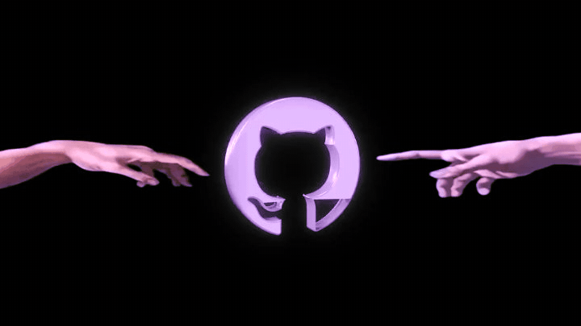
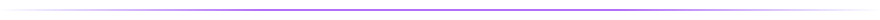
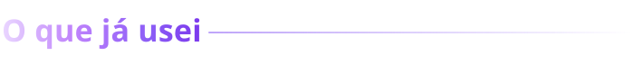
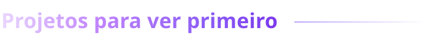
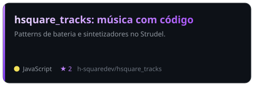
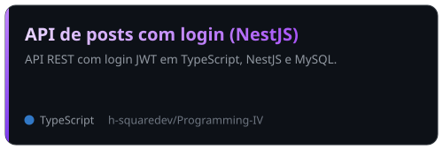
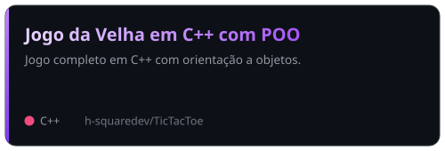

  
# Oi, eu sou o Humberto 👋

Estudante de Ciência da Computação na UFMT (4º semestre), em Barra do Garças - MT.
Estou aprendendo construindo: os trabalhos das disciplinas e os projetos ficam aqui.

- **C e C++**: estruturas de dados (grafos, árvores, listas, heap) e POO
- **Java**: herança e polimorfismo
- **Python**: primeiros trabalhos da faculdade (inclui um jogo com PyGame)
- **TypeScript, NestJS e MySQL**: API REST com login JWT
- **HTML e CSS**: páginas e uma Pokédex
- **Git e GitHub**, Linux e Docker (em estudo)

Cursando as disciplinas Engenharia de Software, Estrutura de Dados I, Programação III, Lógica Digital, Cálculo Numérico e Computacional e Introdução ao Eletromagnetismo na UFMT. Procurando estágio.
